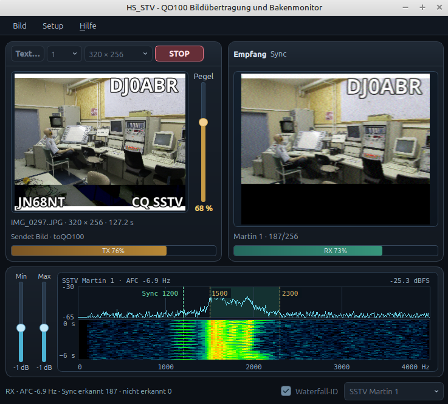
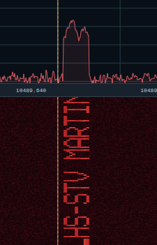
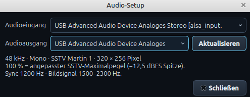
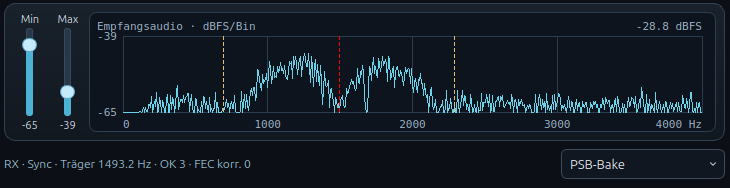
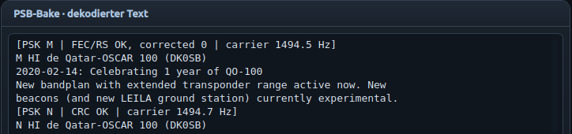
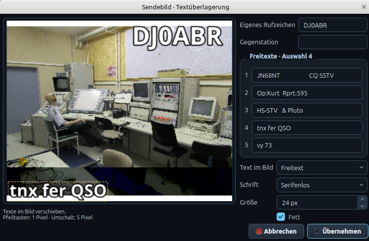
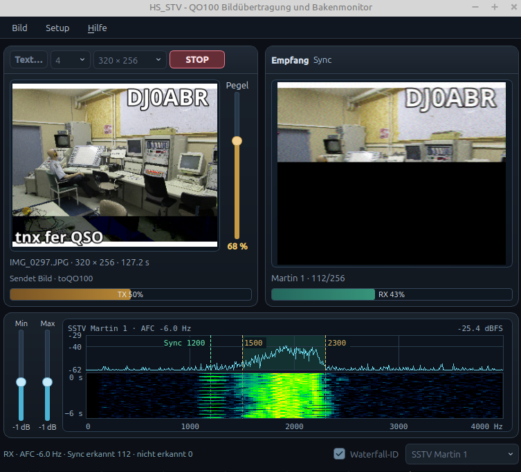
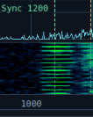
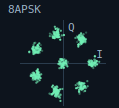

[🇬🇧 English](README.md) · [🇩🇪 Deutsch](README_DE.md)

# HS-STV – Digital and analog image transmission and beacon monitoring for AMSAT QO-100

HS-STV transmits and receives digital and analog images over the narrowband (NB) transponder of the QO-100 amateur radio satellite. It also decodes the PSK beacon and the multimedia beacon.

The program runs on Windows and Linux and only needs an audio connection to your radio or SDR software.

## Analog image transmission

* SSTV Martin-1

* SSTV Martin-2

* SSTV Scottie-1

* SSTV Scottie-2

## Digital image transmission

* 8APSK (high speed)

* QPSK (medium speed)

## Beacon monitoring

* PSK beacon decoder

* Multimedia beacon decoder

## Waterfall text

Enable waterfall text to announce an upcoming transmission.

# Installation

Click **Releases**.

Prebuilt packages are available for Windows and Linux.

* **Windows — HS-STV-Setup-x64.exe**. Run the installer on Windows, then launch HS-STV from the Start menu or the desktop icon.

* **Linux ARM64 (Raspberry Pi) — HS-STV-1.0.0-aarch64.AppImage**. The AppImage includes everything you need and runs without installation. After downloading it, make the file executable, then click or double-click it to start HS-STV.

* **Linux PC — HS-STV-1.0.0-x86_64.AppImage**. The AppImage includes everything you need and runs without installation. After downloading it, make the file executable, then click or double-click it to start HS-STV.

# Initial setup

Choose the audio devices for transmitting and receiving. Device names vary by system. They are usually USB audio adapters. Icom radios often appear as PCM2901 or a similar name.

Once your audio devices are set up, you can start operating. With the correct audio input selected and the radio switched on, you should see noise in the spectrum display.

# QO-100 PSK beacon reception test

Tune your receiver to the PSK beacon at the center of the QO-100 narrowband transponder. The spectrum should look like this.

The decoded text appears after about half a minute.

You can now try other modes, such as SSTV Martin-1, and listen for SSTV transmissions.

# SSTV transmission test via QO-100

HS-STV operates in full duplex. QO-100 relays the image you send, and HS-STV can receive it while transmitting. This lets you fine-tune your transmit and receive frequencies.

* Select **SSTV Martin 1**.

* Tune your radio to an unused frequency in the digital portion of the band plan.

* Click the left image panel and choose an image from your computer. HS-STV scales the image automatically.

* Click **Text…** to set up your callsign and up to five selectable text overlays.
  

* Enable **Waterfall-ID** if you want to announce the operating mode in the waterfall.

* Select text overlay 1 to 5. Analog SSTV always uses a resolution of 320 × 256 pixels.
  

* Set a moderate transmit level, put your radio into transmit mode, and click **Transmit**.

You should now receive your own transmission via QO-100. Fine-tune the frequency until the SSTV sync pulses align with the sync line.

# Digital image transmission

* Select 8APSK at 6 kbit/s or QPSK at 4.4 kbit/s.

* Set up the text overlay as described above. In digital modes, you can also choose the image resolution.

* Click **Transmit**.

* Check the quality of the signal received from QO-100 in the constellation diagram. The points should be clearly distinguishable. Adjust the transmit level if needed.
  

* Digital transmission preserves the quality and sharpness of the original image.

* 8APSK requires a cleaner received signal. If the signal is too noisy, QPSK can give better results with a slightly longer transmission time.

# Transmission times

These times apply at 320 × 256 pixels for analog modes and 320 × 240 pixels for digital modes.

| Mode             | Transmission time | Quality          |
| ---------------- | ----------------: | ---------------- |
| SSTV Martin 1    |             115 s | Analog, noisy    |
| SSTV Martin 2    |              60 s | Blurry and noisy |
| SSTV Scottie 1   |             110 s | Analog, noisy    |
| SSTV Scottie 2   |              72 s | Blurry and noisy |
| 8APSK 6000 bit/s  |              56 s | Matches original |
| QPSK 4410 bit/s   |              79 s | Matches original |
