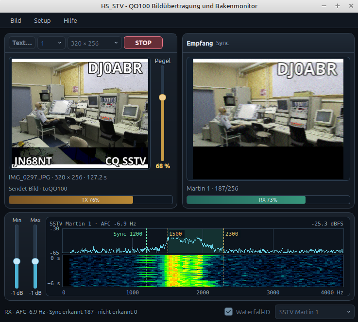
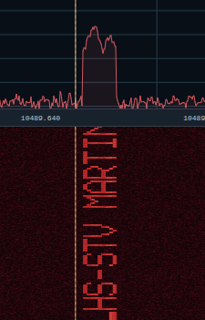
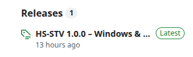
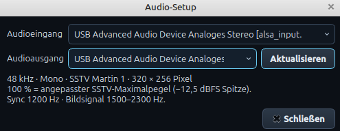
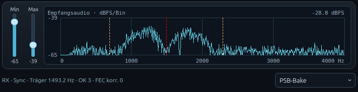
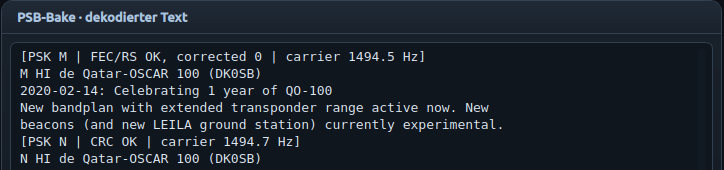
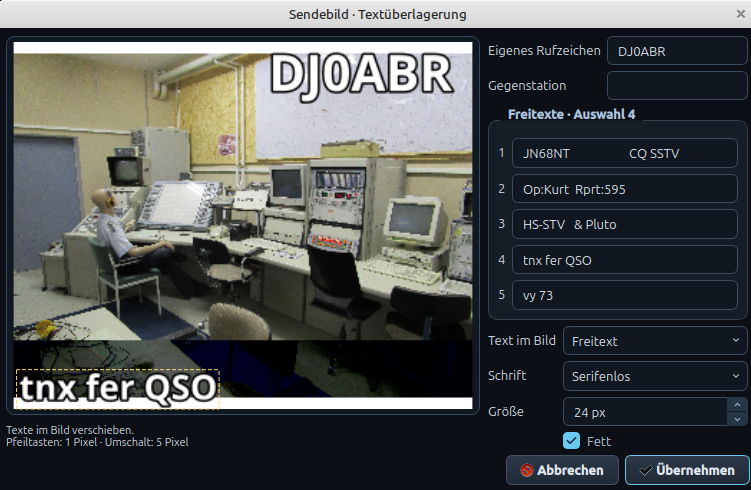
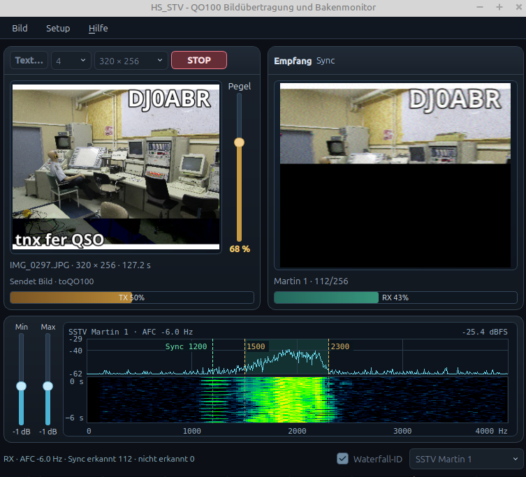
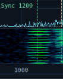
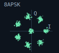

[🇬🇧 English](README.md) · [🇩🇪 Deutsch](README_DE.md)

# HS-STV – digitale & analoge Bildübertragung und Bakenmonitor für Amsat QO100

HS-STV ist ein Programm zur digitalen und analogen Bildübertragung über den Schmalbandtransponder (NB) des Amateurfunksatelliten QO-100. Zusätzlich können die PSK-Bake und die Multimedia-Bake dekodiert werden.

Das Programm läuft unter Windows und Linux und benötigt lediglich eine Audioverbindung zum Funkgerät oder zur SDR-Software.

## analoge Bildübertragung:

* SSTV Martin-1

* SSTV Martin-2

* SSTV Scottie-1

* SSTV Scottie-2

## digitale Bildübertragung:

* 8APSK high speed

* QPSK medium speed

## Bakenmonitor:

* PSK Bakendecoder

* Multimedia Bakendecoder

## Wasserfall-Text:

zuschaltbarer Wasserfall Text für die Ankündigung einer Aussendung

# Installation

Klicke auf "Releases":

Hier findet man fertige, lauffähige Pakete für:

* **Windows: HS-STV-Setup-x64.exe**, dieses SETUP Programm unter Windows starten. HS-STV wird dann installiert und kann über das Menü oder Desktop Icon gestartet werden

* **Linux ARM64 (Raspberry): HS-STV-1.0.0-aarch64.AppImage**, dieses Image enthält sämtliche erfoderlichen Komponenten, eine Installation ist nicht erforderlich. Nach dem Download gibt man der Datei Ausführungsrechte und kann dann mit Anklicken (oder Doppelklick) HS-STV starten

* **Linux PC: HS-STV-1.0.0-x86_64.AppImage**, dieses Image enthält sämtliche erfoderlichen Komponenten, eine Installation ist nicht erforderlich. Nach dem Download gibt man der Datei Ausführungsrechte und kann dann mit Anklicken (oder Doppelklick) HS-STV starten

# Ersteinrichtung

hier stellt man die gewünschten Soundkarten zum Senden und Empfangen ein. Die genauen Bezeichnungen sind systemabhängig. Meist sind es USB Adapter oder bei Icom Geräten heißt es oft PCM2901 usw.

Sind die Soundkarten eingestellt kann der Funkbetrieb beginnen. Bei korrekt ausgewähltem Audioeingang und eingeschaltetem Funkgerät sieht man im Spektrum bereits das Rauschen.

# Empfangstest QO100 PSK Bake

man stellt den Empfänger auf die PSK Bake, welche sich genau in der Mitte des QO100 NB Transponders befinden. Das Spektum soll dann so aussehen:

nach ca. einer halben Minute erscheint der dekodierte Text:

jetzt kann man weitere Betriebsarten auswählen, z.B. SSTV Martin-1 und SSTV Sendungen mithören.

# Sendetest SSTV via QO100

HS-STV arbeitet Vollduplex, das bedeutet, gesendeten Bilder werden von QO100 wieder zurückgesendet und können von HS-STV gleichzeitig zur Aussendung auch empfangen werden. Damit kann die Sende- und Empfangsfrequenz sauber eingestellt werden.

* Auswahl: Betriebsart SSTV Martin 1

* Funkgerät auf eine freie Frequenz im Digitalbereich des Bandplans stellen

* linke Bildfläche anklicken und ein Bild auf dem PC auswählen (Format ist egal, es wird automatisch gezoomt).

* "Text..." anklicken. Hier können Rufzeichen und bis zu 5 wählbare Texte hinterlegt und dem Bild überlagert werden
  

* wenn gewünscht "Wasserfall-ID" aktivieren um die Betriebsart im Wasserfall anzukündigen.

* das gewünschte Text Overlay 1 bis 5 auswählen. Die Auflösung ist bei analogem SSTV immer 320x256
  

* einen mittleren Pegel einstellen, das Funkgerät auf Sendung stellen und "Senden" drücken.

man empfängt jetzt die eigene Aussendung via QO100. Dabei kann man die Freqenz fein justieren, damit die SSTV SYNC Impulse auf der Sync Linie liegen:

# digitale Bildübertragung

* 8APSK mit 6kbit/s oder QPSK mit 4,4kbit/s wählen.

* sonstige Einstellungen (Text-Overlay) wie oben, aber zusätzlich kann man die Bildauflösung einstellen.

* "Senden" drücken

* die Qualität des von QO100 empfangenen Signals im Konstellationsdiagramm prüfen. Die Punkte sollten klar unterscheidbar sein, ggf. den Sendepegel nachstellen:
  

* durch die digitale Übertragung ist das Bild gestochen scharf in identischer Qualität wie das gesendete Originalbild.

* 8APSK stellt etwas höhere Anforderungen an die Qualität des Empfangssignals. Fall es zu verrauscht ist, kann man mit QPSK bessere Ergebnisse erzielen, bei etwas langsamerer Übertragung

# Übertragungsgeschwindigkeiten

diese Werte gelten für eine Auflösung von 320x256 Pixel analog oder 320x240 Pixel digital:

| Betriebsart      | Übertragungszeit | Qualität                |
| ---------------- | ----------------:| ----------------------- |
| SSTV Martin 1    | 115 s            | analog verrauscht       |
| SSTV Martin 2    | 60 s             | unscharf und verrauscht |
| SSTV Scottie 1   | 110 s            | analog verrauscht       |
| SSTV Scottie 2   | 72 s             | unscharf und verrauscht |
| 8APSK 6000 bit/s | 56 s             | wie Original            |
| QPSK 4410 bit/s  | 79 s             | wie Original            |
